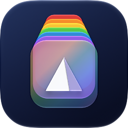
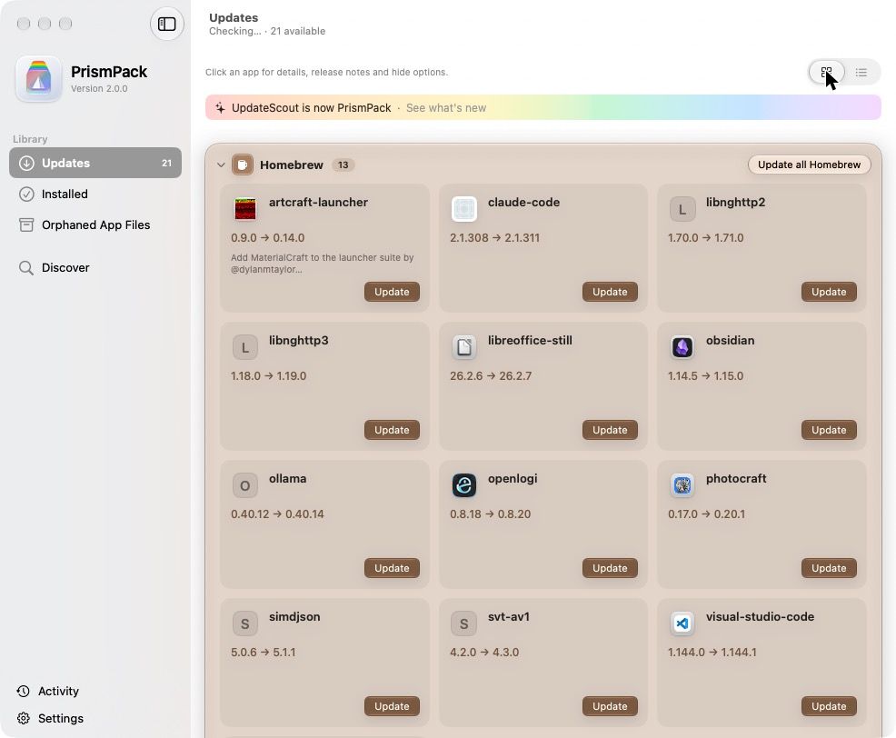
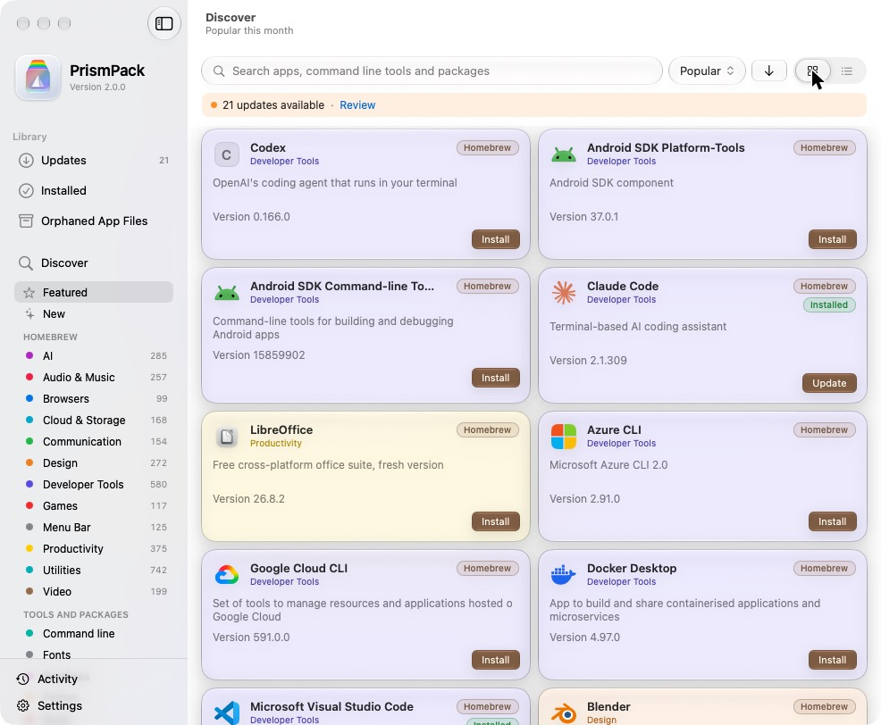
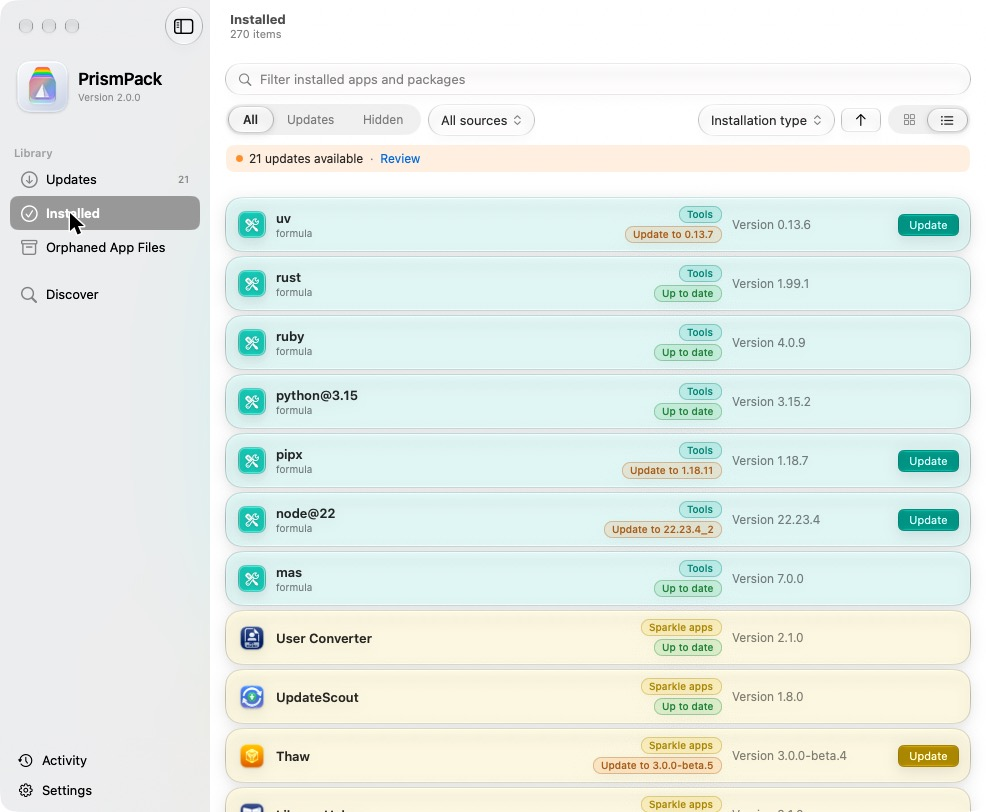
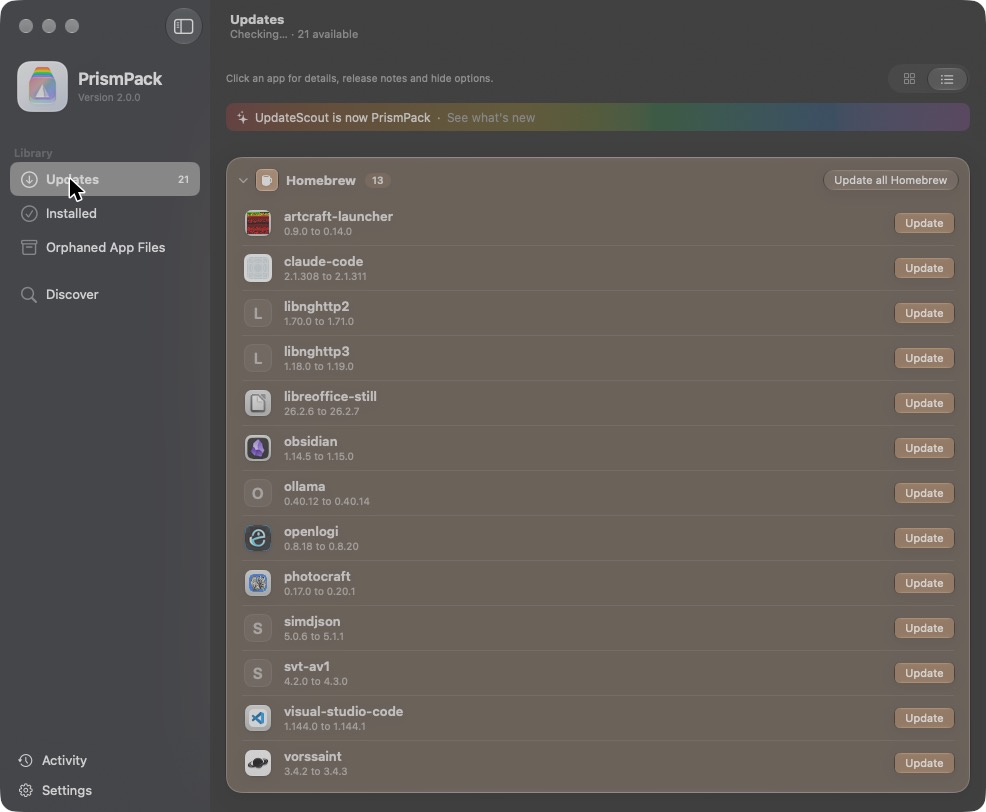
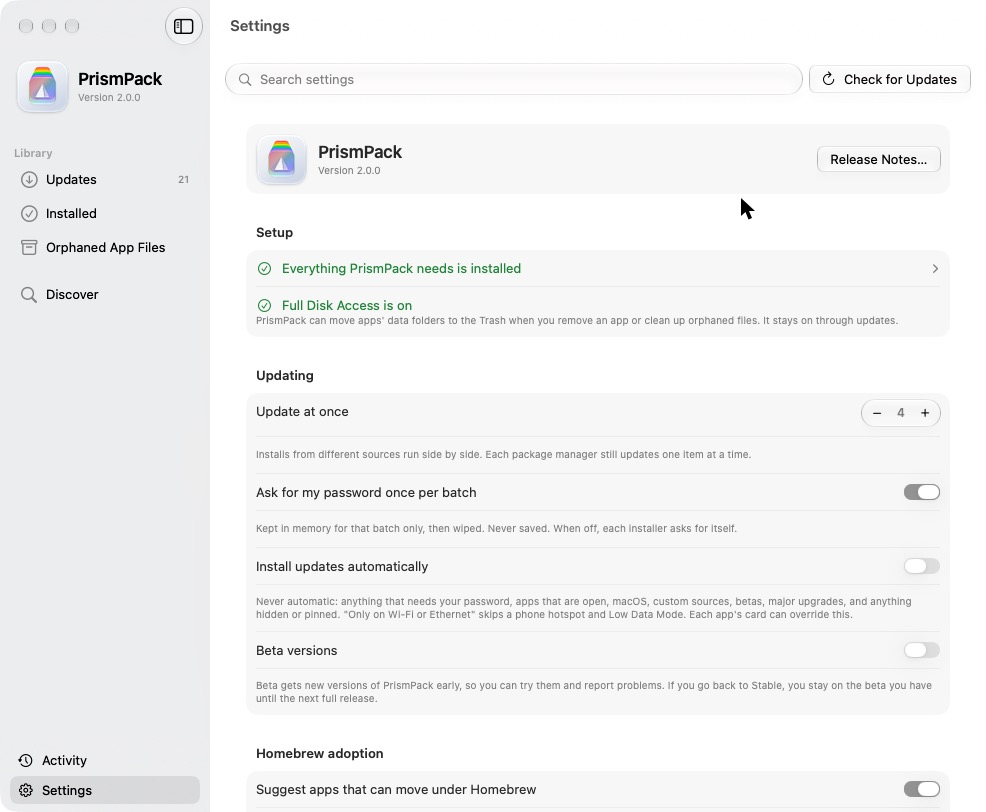

<p align="center">
  
</p>

<h1 align="center">PrismPack</h1>

<p align="center">
  <b>One window for every update on your Mac, and a place to discover what to install next.</b><br>
  Homebrew, the Mac App Store, Sparkle apps, Python, npm, Rust, Ruby, editor extensions, GitHub releases and your own sources, each in its own colour.
</p>

<p align="center">
  <a href="https://github.com/nickstar14/UpdateScout/releases"></a>
  
  
  
</p>

<p align="center">
  <a href="#download">Download</a> ·
  <a href="#screenshots">Screenshots</a> ·
  <a href="#why-prismpack">Why PrismPack</a> ·
  <a href="#the-window">Features</a> ·
  <a href="#update-sources">Sources</a> ·
  <a href="#safe-by-design">Safety</a> ·
  <a href="#upgrading-from-updatescout">Upgrading</a>
</p>

<p align="center">
  
</p>

---

## Why PrismPack

*Formerly **UpdateScout**. Version 2.0 renamed the app; settings, history and
the background check carry over.*

A macOS app (with a menu bar prism) that finds updates across everything on the
Mac, helps you find and install new apps and tools, and looks after what's
already installed. Updates install only when you click, one item at a time or
in a batch you start. **Automatic updates are off until you turn them on**, and
never run for anything that needs your password, apps that are open, macOS,
betas or major upgrades. Requires macOS 15 or later on a Mac with Apple silicon.

A prism takes a single beam of white light and reveals every colour inside it.
PrismPack does the same for your Mac: one window that shows all your software,
the files deleted apps leave behind, and a place to discover and install new
software, each in its own colour.

| | |
|---|---|
| **Updates** | Every available update in a section per source, with progress you can see, one password per batch, and release notes on the card. |
| **Discover** | Find and install apps, tools, fonts and extensions from Homebrew, npm, PyPI, crates.io, RubyGems and the editor stores. |
| **Installed** | Everything on your Mac in one list, filtered by source, with duplicates compared side by side. |
| **Clean-up** | Uninstall to the Trash with the files an app left behind, and find orphaned app files. |
| **Control** | Stable or Beta per app, automatic updates you switch on, and ways to hide what you don't want. |
| **Light** | About 15 MB in the menu bar. Closing the window frees most of what it was using. |

## Screenshots

<table>
  <tr>
    <td align="center"><br><sub><b>Discover</b>: browse by category, popularity or what's new</sub></td>
    <td align="center"><br><sub><b>Installed</b>: everything on your Mac, by source</sub></td>
  </tr>
  <tr>
    <td align="center"><br><sub><b>Updates</b> in the dark theme</sub></td>
    <td align="center"><br><sub><b>Settings</b>: search, tools, and release notes</sub></td>
  </tr>
</table>

## Download

1. Open the [Releases page](https://github.com/nickstar14/UpdateScout/releases) and download the latest `.zip`.
2. Unzip it and drag **PrismPack** to your Applications folder.
3. Open it. A prism appears in the menu bar; click it to open the window.

Requires **macOS 15 or later** on a Mac with **Apple silicon**. The Liquid
Glass look needs macOS 26; earlier versions get a simpler look. Homebrew is
expected, and `mas` is optional (the App Store row in Settings tells you how to
enable it). PrismPack updates itself after the first install.

> **Betas.** New versions may start as a beta, marked *Pre-release* on the
> Releases page. Once you run a beta, PrismPack offers you later betas and the
> final release. Settings has a **Beta versions** switch if you want to follow
> betas from a stable install.

## Upgrading from UpdateScout

Updates from UpdateScout 1.8.0 keep your settings, history, hidden updates,
sources and background check. On first launch the app renames itself to
`PrismPack.app`, moves its data to `~/Library/Application Support/PrismPack/`
and restarts its background check under the new name. Because macOS sees a new
app, it asks again for notifications and Full Disk Access (optional). If you use
a menu bar manager such as Thaw, Ice or Bartender, the prism may need placing
again once.

## Safe by design

- **Nothing installs without a click**, unless you turn automatic updates on, and
  even then never for anything that needs your password, apps that are open,
  macOS, betas or major upgrades.
- **One password per batch**, kept in memory for that batch only and never saved.
- **Uninstall goes to the Trash**, with a list of what moves shown first.
- **Only a download signed by the same developer** is installed for apps linked to GitHub.
- **Optional Full Disk Access**, only to clear app data macOS protects.

## The window

A sidebar with **Updates**, **Installed**, **Orphaned App Files**,
**Discover**, **Activity** and **Settings**. Left-click the menu bar prism to
open it; right-click for Check Now, Settings and Quit.

- **Updates:** every available update in a section per source, as cards or a
  list. Updates run side by side (you choose how many); each package manager
  still does one thing at a time. A progress bar with a percent shows while a
  download can be measured, and a step line (Verifying, Installing…) otherwise.
  One password covers a whole batch and is kept in memory for that batch only.
- **Installed:** everything on the Mac in one list, filtered by source, sorted
  by name, size, date or type, as cards or a list. Duplicates (two copies of an
  app, or an App Store app Homebrew also tracks) are compared side by side;
  nothing moves without asking, and copies go to the Trash.
- **Orphaned App Files:** files left behind by apps you've removed. Nothing is
  ticked; keep them or move what you choose to the Trash.
- **Discover:** find and install new apps and tools from Homebrew, npm, PyPI,
  crates.io, RubyGems and the editor extension stores, by popularity, newest or
  category. A pop-up shows the app's own description and pictures from its
  website; fonts show a preview and their styles.
- **Activity:** installs, updates, removals, failures and checks, kept until
  you delete them.

## Update sources

| Source | Detects via | Updates via |
|---|---|---|
| Homebrew | `brew outdated --json=v2` | `brew upgrade [--cask] <name>` |
| Mac App Store | `mas outdated` (needs `brew install mas`) | `mas upgrade <id>` |
| macOS | `softwareupdate -l` | opens Software Update in System Settings |
| Other apps (cask oracle) | Matches installed apps against Homebrew's cask database | Offers to move the app under Homebrew, only when you click |
| Sparkle apps | `SUFeedURL` in app Info.plists, appcast compared by version and release track | In-place install from the vendor's signed download |
| GitHub releases | Apps you link to a GitHub project | Only a download signed by the same developer (unsigned apps after a clear warning) |
| Python, npm, Rust, Ruby gems | pipx / uv, `npm`, `cargo`, `gem` | Each tool's own command |
| Editor extensions | VS Code, VSCodium and Cursor | The editor's CLI |
| Custom sources | `custom_sources.json`: plist/command for the installed version, URL + regex/JSON-path for the latest | A shell command per entry, or opens the vendor page |

## Build & install

```bash
scripts/build-app.sh --install   # builds build/PrismPack.app and copies it to /Applications
open /Applications/PrismPack.app
```

Requires Xcode command line tools and a macOS 27 SDK. Homebrew is expected;
`mas` is optional (the App Store row tells you how to enable it). The build
is signed with the self-signed "PrismPack Signing" certificate
(`scripts/make-signing-cert.sh` makes it once) so Full Disk Access survives
updates. Releases use `scripts/release.sh`; see `CLAUDE.md`.

## Background checks

Settings → "Check for updates in the background" installs a launchd user agent
(`~/Library/LaunchAgents/com.nickszun.prismpack.check.plist`) that runs the
app binary with `--background-check` on the chosen interval. That mode detects
and notifies; installs happen from the window (or automatically, if you've
turned that on).

Notifications fire only for updates not seen before (new app or new version).
"Ignore this version" suppresses an item until a newer version appears; you can
also hide all of an app's updates, or only its major upgrades.

## Files

Everything is under `~/Library/Application Support/PrismPack/` (version 2.0
moved it there from `UpdateScout/` and carried your preferences over):

- `state.json`: state, activity and hide lists (always changed through
  `Store.mutate`: the app and the background agent both write it)
- `custom_sources.json`, `github_sources.json`: the sources you added
- `cask-index.json`: Homebrew's cask index (refreshed daily)
- `github-releases.json`, `github-notes.json`: GitHub release caches
- `discover-*.json`, `discover-icons/`, `discover-details/`: Discover's lists,
  icons, and the descriptions and pictures from apps' websites (capped at 50 MB)

## Known limitation

There is no unified API for third-party driver/firmware updates on macOS.
Vendors like DisplayLink distribute their own installers with no auto-update.
Homebrew's cask database is the best available proxy (maintainers already track
vendor releases); anything without a cask goes in `custom_sources.json`, where
"open the download page" is the guaranteed baseline action.
